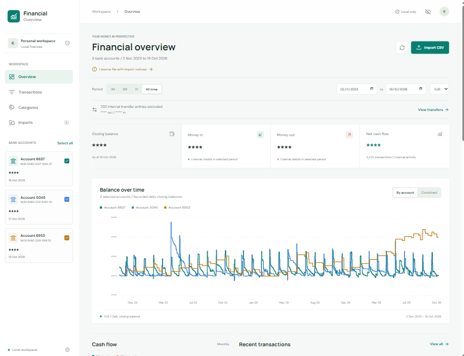
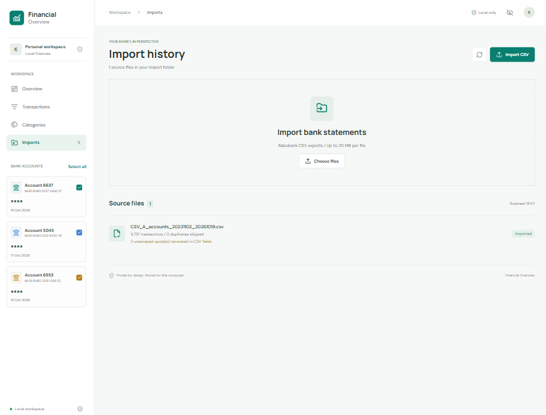
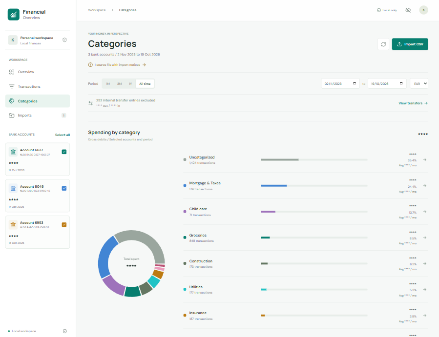
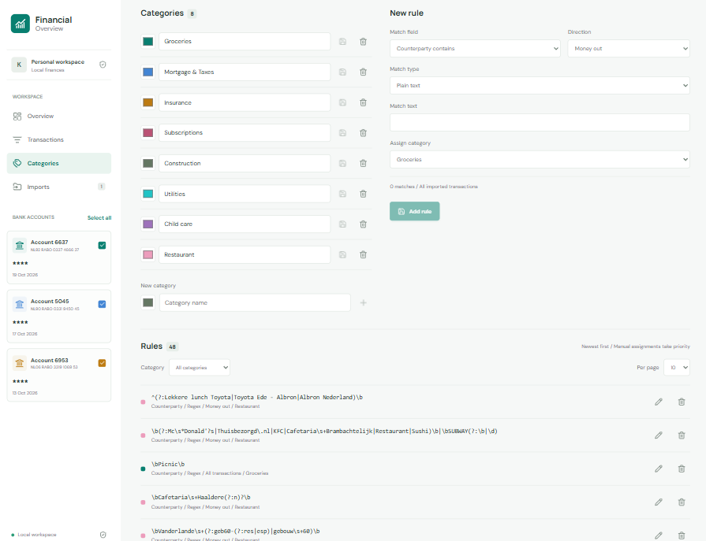
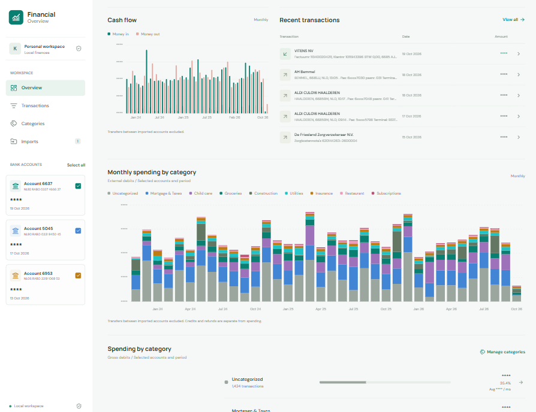
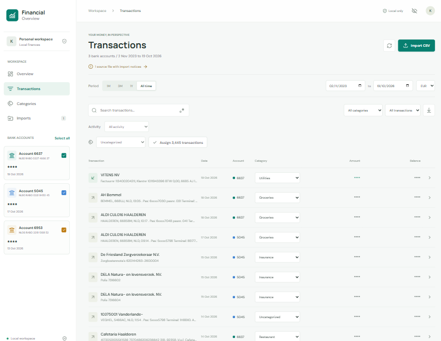

# Financial Overview

A local bank-account dashboard. Reads CSV exports from the workspace's `import/` folder and charts recorded daily closing balances for individual or combined accounts. Includes date filters, monthly gross cash flow, searchable transactions, categories, reusable categorization rules, transaction details, CSV download, and import reports.



## Run in WSL

Requires Node.js 22.12+ (or a newer supported Node.js release) and npm inside WSL.

```sh
cd /mnt/c/dev/KingTech/KingTech.FinancialOverview/dashboard
npm install
npm run dev
```

Open the localhost URL printed by Vite in your Windows browser. If the default port is occupied, Vite chooses the next available port. The server binds to loopback only; do not expose this financial data to your network.

## Imports



- Existing CSV files load automatically on opening the app.
- Add files to `./import/` and click the rescan icon, or upload/drop files in the Imports view. Uploaded files are validated before being saved to that same folder. Existing files are never overwritten.
- Import state is rebuilt from the source CSVs on refresh/rescan. No database or browser storage is required. To remove a source, move it out of `import/` and rescan.
- Supported format: Rabobank transaction CSV with the Dutch headers `IBAN/BBAN`, `Munt`, `Volgnr`, `Datum`, `Bedrag`, and `Saldo na trn`. Amounts use decimal commas, dates use `YYYY-MM-DD`, and UTF-8 / Windows-1252 are supported. Other banks' layouts require an additional format adapter.
- Overlapping exports are deduplicated by account, currency, and transaction sequence. Conflicting duplicates reject the entire affected file and appear in the import report. Malformed files do not prevent valid files from loading.
- Maximum file size: 20 MB. Literal unescaped quotes that the CSV parser can recover are reported as warnings; invalid dates, amounts, field counts, or unrecoverable quoting reject the file.

## Transaction Categories



Bank CSVs are read-only source exports. Categorizing a transaction never updates a CSV. Category definitions, rules, and manual assignments are stored separately in `dashboard/data/categories.json` (relative to the workspace root), which is created on the first save and excluded from Git.

- Open **Categories** to manage Groceries, Mortgage, Insurance, Subscriptions, or your own categories. Names and colors are editable.
- Assign an individual transaction from its category dropdown or details dialog. In **Transactions**, search/filter first and use the bulk assignment control to assign all matching results, not just the visible page (up to 10,000 at once).
- Create a rule by matching counterparty/description text (case-insensitive contains) or a counterparty account (case-insensitive exact match), with an optional money-in/out restriction. The match preview covers all imported dates, accounts, and currencies. Rules affect existing and future matching transactions.
- The saved rules list is paginated: 10 rules per page by default, with 25 and 50 available. Filter the list by category or choose All categories. Counts and page ranges reflect the filtered rules; changing the filter or page size returns to page one. The list stays newest-first, and these display controls do not change matching priority or saved rules.
- The newest matching rule wins. Manual assignments, including explicitly choosing Uncategorized, take priority over rules. Choose **Use rules (clear override)** to remove a manual assignment.
- Open a transaction's details and choose **Create rule** to prefill a rule from that transaction. Review the match text and preview before saving; payment processors can represent several merchants.
- The spending breakdown shows external gross debits in the selected period, account selection, and currency. Click a category name or pie slice to open its detailed spending page. Refunds remain credits and are not netted against spending. Detected transfers between imported accounts are excluded from all spending and cash-flow reports. Category filtering does not alter recorded account balances.
- Deleting a category removes its rules and makes its manual assignments Uncategorized. Deleting a rule affects automatic matches but leaves manual assignments alone. Deletions require confirmation.
- Category names are included in downloaded transaction views. The original bank export is never rewritten.



Assignments use the stable account/currency/sequence transaction ID, so they survive app restarts, rescans, and overlapping exports. Back up **both** the source `import/` folder and `dashboard/data/`; the CSVs alone cannot restore your categories. Corrupt metadata is reported rather than silently overwritten. If another window saves first, rescan before retrying a stale update.

### Spending Charts and Category Details



Overview and Categories include a spending pie chart, with each slice proportional to the category's gross debits. Zero-spend categories remain accessible in the category list but do not create slices. A period with no spending shows an empty state rather than a fabricated chart.

Each category's detail page shows total spent, credits, transaction count, counterparty group count, and a merchant spending pie chart. Click a merchant slice or row, or choose a counterparty from the menu, to filter the paginated transaction list. The full category totals and pie remain unchanged while drilling into a merchant. **All categories** returns to the category list; **Open in transactions** opens the full transaction explorer filtered to that category. The selected accounts, date period, and currency apply throughout.

AH and Albert Heijn name variants are grouped as **Albert Heijn (AH)**, and ALDI locations as **ALDI**. Other counterparties are grouped by their case/whitespace-normalized name, ignoring common leading payment-terminal prefixes (`BCK*`, `CCV*`, `PAY.nl*`, `SumUp*`). Unnamed counterparties use the counterparty account when available, or **Unknown counterparty** otherwise. This is display-only grouping, not an additional categorization rule; the original transaction names remain available in the transaction list and details. Unknown brands are not automatically merged by bank account, since payment processors can represent unrelated merchants.

Pie charts use external spending only, not transaction counts or balances. Credits/refunds are displayed separately and never produce negative slices. Detected internal transfers are excluded from category/merchant totals, counts, and detail transaction lists, regardless of any existing category assignment. All monetary aggregation uses integer cents and one selected currency. These charts do not modify source CSVs, category assignments, or saved rules.

### Internal Transfers

The app detects internal transfers when a transaction's counterparty account matches a **different** account present anywhere in the imported transactions. Account identifiers are compared without whitespace and without case sensitivity. Detection uses the complete import, not the current account selection, date period, or currency. No equal-amount/opposite-leg match is required, so a transfer is still recognized if the other account's entry falls outside the selected period or its export has incomplete coverage.

Same-account references are not treated as internal transfers: bank fees can reference the charged account itself. Merchant names, descriptions, and coincidentally equal amounts are never used to infer ownership. Transfers to accounts that have not been imported, or with a missing counterparty account, cannot be automatically identified and remain external activity.

Detected transfers are excluded from money in/out, net external cash flow, monthly cash-flow bars, category spending pies, and merchant breakdowns. Closing balances, balance history, and the full transaction history still include every original transaction. A single account's balance movement therefore need not equal its external net cash flow. Different currencies are still reported separately without conversion.

Reports show the excluded transfer entry count and incoming/outgoing totals for the selected accounts and period. The count is **bank entries**, not matched transfer pairs: a transfer may contribute two entries when both legs are present. Choose **View transfers**, or use the **Activity** filter in Transactions, to review internal transfers, external activity, or all activity. Transfer entries are labeled in the table and details. They are excluded from bulk category assignment, and their existing assignments/rules are preserved rather than rewritten. Downloaded transaction views include an **Internal transfer** flag; the original CSVs are unchanged.

### Regex Filters



Transaction search has a **Use regular expression** icon toggle. Category rules have a **Match type** menu: choose **Regular expression (RE2)**. Plain text remains the default, and existing saved rules retain their original behavior.

Enter the pattern itself, without surrounding `/` delimiters or trailing flags. Matching is case-insensitive by default. For example, use this counterparty rule with **Money out** and **Groceries**:

```regex
^AH\s+(Bemmel|Opheusden)$
```

This matches either AH branch, without matching an unrelated name containing `AH`. To include older Albert Heijn names and other AH branches, use `^(AH\b|Albert Heijn\b)` instead. Check the live preview before saving.

Patterns support anchors, alternation, character classes, word boundaries, and quantifiers. Matching uses RE2 through `re2js`, avoiding catastrophic backtracking. Lookarounds and backreferences are not supported. Patterns are limited to 200 characters; regex escapes, capitalization, and leading/trailing whitespace are preserved. Invalid or unsupported patterns show an error, match nothing, and cannot be saved. Regex transaction searches apply independently to the same fields as text searches: counterparty, description, bank account, counterparty account, date, and amount. Search is temporary; only saved categorization rules persist, separately from the unchanged CSV exports.

## Balance Semantics

Balances come from `Saldo na trn`, not from an assumed zero opening balance. Transactions are ordered by booking date and numeric sequence; the final transaction per date defines the daily close. The previous known balance is carried forward across dates without activity. An account has no plotted balance before its first recorded transaction, and combined balance starts only when every selected account has a known balance. A historical closing balance uses the last known value on or before the selected end date. Gaps in the source exports cannot be reconstructed.

Different currencies are never summed or converted. Money in/out are external gross credits/debits after excluding detected transfers between imported accounts, not classified income/expenses. Sidebar balances show each account's latest recorded balance regardless of the selected period. Date presets are relative to the most recent transaction in the selected currency, not today's date.

The download button exports the filtered transaction view for analysis; it is not a Rabobank-format backup for reimport. Hide amounts masks displayed values, not the underlying locally loaded data or CSV downloads.

## Privacy

No analytics, external APIs, remote fonts, or cloud storage. Data and assets are served locally. Import endpoints reject cross-origin requests and file path traversal. Source CSVs remain unmodified by parsing. Back up and protect the `import/` folder as you would bank statements. The local app has no login and is not intended for hosting on a shared or public server.

## Checks and Build

```sh
npm test
npm run lint
npm run build
npm run preview
```

`preview` serves the production build together with the local import API. Do not open `dist/index.html` directly or deploy it to a static host: folder access needs the local server. Tests include the supplied export, synthetic financial edge cases, and local API upload/security checks. The real-export test expects the original supplied file to remain in `import/`.
